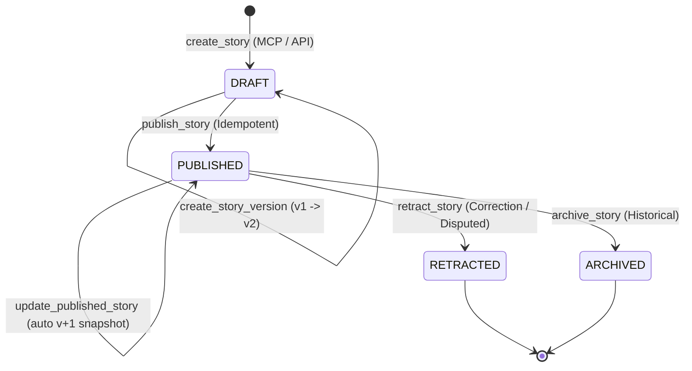

# Story Model, Versioning & WhatChanged Diff Engine

This document details the story lifecycle, immutable revision snapshotting, provenance tracking, and the algorithmic `WhatChanged` diff engine.

---

## 1. Story Lifecycle State Machine

A story transitions through strictly guarded lifecycle states:



### State Guard Rules:

- **DRAFT**: Editable by authorized agents. Not exposed to public search or 4K wall tickers.
- **PUBLISHED**: Immutable public snapshot. Any subsequent edit generates a new incremented version number (`v2`, `v3`) while preserving historical records.
- **RETRACTED**: Preserves the story URL and block tree, but injects a mandatory red editorial retraction banner explaining why the article was withdrawn.
- **ARCHIVED**: Read-only historical record removed from live breaking feeds.

---

## 2. Immutable Versioning Architecture

Whenever an external AI agent updates an existing story via `create_story_version` or `update_story`:

1. **Snapshot Creation**: The current state of `blocks`, `title`, and `summary` is committed to the `StoryVersion` table as an immutable record:
   ```typescript
   const snapshot: StoryVersion = {
     id: generateId('ver'),
     storyId: story.id,
     versionNumber: story.currentVersionNumber,
     title: story.title,
     summary: story.summary,
     blocks: story.blocks,
     whatChanged: input.whatChanged,
     authorId: principal.actorId,
     createdVia: principal.clientType,
     createdAt: new Date().toISOString(),
   };
   ```
2. **Atomic Increment**: The parent `Story` record increments `currentVersionNumber` and references the new snapshot `currentVersionId`.
3. **Audit Recording**: An immutable audit log entry is saved with the caller's cryptographic client ID (e.g. `gemini_spark_agent`, `chatgpt_science_desk`).

---

## 3. The WhatChanged Diff Engine

In rapidly developing news (e.g. diplomatic summits, natural disasters, financial earnings), readers and editors must know **what changed between revisions**.

The platform generates and renders a dedicated `what_changed` block at the top of subsequent revisions:

```json
{
  "id": "wc_brics_rev3",
  "blockType": "what_changed",
  "sortOrder": 0,
  "data": {
    "previousVersionNumber": 2,
    "updatedAt": "2026-09-26T14:45:00Z",
    "items": [
      {
        "changeType": "added",
        "description": "Incorporated official Joint Communiqué terms on shared compute clusters.",
        "affectedSection": "paragraph"
      },
      {
        "changeType": "updated",
        "description": "Updated Intra-Bloc Settlement chart with verified 2026 Q3 central bank data.",
        "affectedSection": "chart"
      },
      {
        "changeType": "corrected",
        "description": "Corrected ratification count: 10 member states unanimously confirmed, not 9.",
        "affectedSection": "heading"
      }
    ]
  }
}
```

### Visual Diff Presentation:

- **`added`**: Highlighted in emerald green with `+` indicator.
- **`updated`**: Highlighted in blue with `~` indicator.
- **`corrected`**: Highlighted in amber with `!` correction badge.
- **`retracted`**: Highlighted in crimson with `×` retraction notice.

---

## 4. Story Summaries in Listing Payloads

A story carries its blocks. A **listing** does not need them.

Collections, the editorial kanban board, the editorial calendar and the full-coverage cluster view
all hold many stories at once, and each of those payloads used to embed the full story
schema — and therefore the whole story-block union. The inferred type of the containing
schema then grew with every block type the platform added, until TypeScript refused to
serialize it at all.

So those payloads carry a **`StorySummary`** instead: everything needed to identify, label and
link to a story, and nothing else. The blocks are fetched on demand when a story is opened.

```typescript
// libs/schemas/src/story.ts
export const StorySummarySchema = z.object({
  id,
  organizationId,
  slug,
  title,
  summary,
  status,
  articleType,
  currentVersionNumber,
  topicIds,
  entityIds,
  sourceIds,
  categories,
  heroImageUrl,
  createdVia,
  createdByClient,
  authorId,
  publishedAt,
  scheduledPublishAt,
  wordCount,
  readingTimeMinutes,
  createdAt,
  updatedAt,
  // no `blocks`, no `idempotencyKey`
});
```

The rules that follow from it:

- **A summary payload never embeds `StorySchema`.** `toStorySummary()` and
  `toStorySummaries()` do the stripping, so the omission is in one place.
- **The block union stays out of listing types.** The remaining places that legitimately
  carry blocks — a story, a story version, a content template's default blocks — are the
  ones that _are_ the content.
- **A guard test keeps it that way.** `tests/unit/schemas/story-summary.test.ts` parses a
  full story through every summary payload and asserts the blocks are gone. Re-embedding the
  full story schema brings them back, and the test fails.

The effect is that adding a block type no longer changes the type of any listing payload, so
the block catalog can grow without the schemas around it growing with it.
